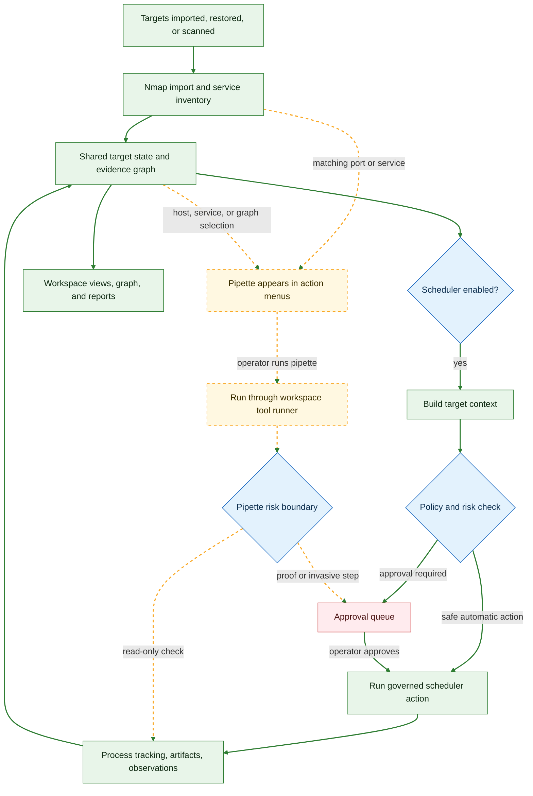

# LEGION

## T3-inspired desktop fork

This public fork of [Hackman238/legion](https://github.com/Hackman238/legion) adds a near-black workspace, searchable navigation (`Ctrl K`), resizable host/detail panes, compact original menus, and a bottom status bar. The CTF workspace keeps hosts, services, graph/matrix views, jobs, scheduler rationale, credentials/relay, approvals, essential settings and workspace ZIP backup/restore. The optional native Qt WebEngine window uses this same interface and local backend without a browser tab. This fork is not affiliated with T3 Code.

Click the workspace title to rename it with its current name selected; Enter or clicking away saves, and Escape cancels. Names travel with the project through save/open and ZIP export/restore. Right-click the sidebar workspace (or press Shift F10 while it is focused) for rename, save, export and details actions. Sidebar Rename edits the name in place in the sidebar; clicking the top title edits it at the top. Both names stay synchronized. The graph fits visible content at its default zoom, with minus/percentage/plus controls in its top-right corner; click the percentage to reset.

For an already provisioned Ubuntu checkout, install the optional dependencies into its local `.venv`, then run `scripts/install-desktop.sh`. Search Applications for **Legion**, or run `legion`. `Ctrl R` reloads the window and `Ctrl +` / `Ctrl -` adjust zoom. The backend continues running when the window closes. Use `journalctl --user -u legion.service` for backend logs. Installation replaces this user's Legion launcher and Legion user services.

```sh
UV_CACHE_DIR="$PWD/.cache/uv" .tools/uv pip install --python .venv/bin/python -r requirements-desktop.txt
scripts/install-desktop.sh
legion
```

This checkout requires a dedicated capped filesystem mounted at the project root **before installing dependencies or running the installer**. The original local installation uses a persistent ext4 loop volume backed by an exactly **2,000,000,000-byte** image; filesystem overhead reduces usable capacity. Provision that volume/quota separately on a fresh machine, preserving existing data. The installer verifies the mount and storage budget; it does not create a quota or format disks. `.project-storage.json` alone is not a hard quota.

Keep dedicated Python environments, tools, caches, test output, desktop profiles and runtime data within the mounted root. Use `.cache` for reproducible caches, `.artifacts/disposable` for disposable test output, and `.state` for protected evidence/configuration. The five-second storage watcher cleans designated caches and disposable artifacts at 90% usage or below 100 MB free; the filesystem itself prevents overflow. Source, Git history, environments and evidence are preserved. If protected files fill the volume, new writes fail until space is deliberately reclaimed. Saved projects and exports selected outside this root are outside its quota.

The reusable storage-only Codex skill is in [`skills/project-storage-cap`](skills/project-storage-cap/SKILL.md). To install it elsewhere, copy that directory into your Codex skills directory. Run its `scripts/storage_guard.py --root "$PWD" --check` before and after large operations. The local `.storage-baseline.json` records the initial installation before application edits/tests and is excluded from Git.

Upstream documentation follows. Existing licensing and attribution remain in place.

[](https://snyk.io/test/github/Hackman238/legion?targetFile=requirements.txt)
[](https://codeclimate.com/github/Hackman238/legion/maintainability)

<p align="center">
  
</p>

<p align="center">
  
</p>

## NOTICE

This is the active home of `LEGION`.

`0.7.0` hardens that web-first foundation: the web runtime is split into clearer domains, high-risk execution paths are stricter, bundle restore/export fidelity is improved, workspace filtering is more useful on large engagements, and the first bundled pipettes provide repeatable aggregate checks for high-value service families.

After upgrading, review tool paths and provider settings under `Settings`, especially if you customize Nmap, browsers/screenshot tooling, Responder, NTLMRelay, or AI providers.

## ✨ About

Legion is a local-first, operator-guided reconnaissance and penetration testing platform with deterministic and AI-assisted orchestration.

It supports governed deterministic and AI-assisted orchestration, project-based persistence, explicit approval gates, shared target state, evidence graphing, and a desktop and local web workflow for Kali and Ubuntu operators. AI providers supported include OpenAI, Claude and LM Studio. It also supports any local server that implements the OpenAI API.

The web interface is now the primary interface. Qt remains in-tree for compatibility, but the main product direction is the standalone desktop and local web workspace built on the same orchestration core.

## 🖥 Web Interface (Primary)

Start the primary interface with:

```shell
python3 legion.py --web --web-port 5000
```

Useful web launch variants:

```shell
# Bind on all interfaces
python3 legion.py --web --web-port 5000 --web-bind-all

# Disable transparency effects on slower hosts
python3 legion.py --web --web-port 5000 --web-opaque-ui
```

The web interface includes:

- project create/open/save and workspace ZIP backup/restore workflows
- target import, Nmap XML import, and scan submission
- governed scheduler settings and AI/provider configuration
- live processes, retries, output viewing, and background jobs
- host and service workspace views
- host detail with notes, scripts, screenshots, and contextual actions
- graph workspace with filters, layout management, floating/docked detail inspector, and contextual node actions
- approval queue, submitted scans, and scheduler decision history
- tool audit visibility for checking whether Legion can resolve the external tools it depends on

## 🍿 What Legion Does

- Imports and scans hosts, subnets, FQDNs, and Nmap XML into a persistent project workspace.
- Correlates hosts, services, URLs, technologies, findings, screenshots, credentials, sessions, and evidence in a local graph.
- Runs governed deterministic and AI-assisted follow-up actions from the same action model.
- Applies engagement policy, risk classification, approval gates, and audit logging before risky execution.
- Keeps operator-visible evidence, artifacts, screenshots, execution history, and graph annotations in-project.
- Provides targets, scans, tools, results, notes and an interactive graph in the desktop and local web workspace.

## 🚀 0.7.0 Highlights

- Domain route modules, service wrappers, typed schemas, and focused runtime modules continue the migration away from a monolithic web/runtime surface.
- High-risk execution paths are stricter: bind-all behavior, public tool execution, approval idempotency and provider secret storage were hardened.
- Project bundle export/restore now preserves artifact fidelity more reliably, stages restored projects before swapping the active workspace, and rebases restored paths more consistently.
- Workspace filtering now supports service/open-port filters, host-filtered graph views, service port visibility, improved host/service sync, and stronger OS/category enrichment for phones, Windows systems, and out-of-band management devices.
- Bundled pipettes add repeatable aggregate checks for Cisco Smart Install, internal SMTP/SPF review, Windows SMB/RDP discovery, and IPMI/iDRAC/iLO discovery.
- Runtime reliability improved across Nmap output isolation, screenshots, artifact cleanup, process/tool execution paths, and Responder/NTLMRelay workspaces.
- Regression coverage expanded across routes, schemas, bundles, scheduler/approval flows, graph/reporting, workspace filters, pipettes, and tooling.

## 🧰 Action And Tooling Coverage

Legion 0.7.0 now has three useful coverage counts:

- `289` normalized governed `ActionSpec` entries in the shared orchestrator registry.
- `358` default loaded configured action entries after migrations:
  - `46` scheduler mappings
  - `287` port actions
  - `11` host actions
  - `14` port terminal launchers
- `4` bundled pipettes for focused aggregate checks.

Additional runtime integrations outside static `legion.conf` include:

- normalized banner capture
- browser/screenshot runner with Chromium / Selenium / EyeWitness fallback paths
- Responder workspace integration
- NTLMRelay workspace integration

## 🧪 Pipette Flow

Pipettes are bundled aggregate checks that appear in host, service, graph, and manual action menus when their manifest matches the selected target. They are not part of the default automated scheduler path unless explicitly promoted into a governed scheduler action. Solid green edges show the normal automated path; dashed amber edges show optional/manual pipette paths that require an operator action.



## 🔌 Other Interfaces

### Qt Compatibility

Qt is still in-tree for compatibility and migration purposes, but it is no longer the primary documented path.

## 🌉 Recommended Environments

Legion is best supported today on recent Linux pentest/operator environments:

- current Kali rolling releases
- Ubuntu `22.04 LTS`
- Ubuntu `24.04 LTS`

Recommended baseline:

- Python `3.12+`
- a current Chromium or Firefox install for screenshot workflows
- Nmap plus whichever local tools you want Legion to orchestrate (`nuclei`, `ffuf`, `whatweb`, `smbmap`, `enum4linux-ng`, `wpscan`, and similar)

Legion is local-first by design. It does not require Docker, external databases, or remote services for its baseline workflow.

## 💻 Installation

### Quick Start From Source

```shell
git clone https://github.com/Hackman238/legion.git
cd legion
python3.12 -m venv .venv
source .venv/bin/activate
python -m pip install --upgrade pip
python -m pip install -r requirements.txt
python legion.py --web
```

Open `http://127.0.0.1:5000` unless you used `--web-bind-all`.

### Kali Side-By-Side Dev Install

To install a separate development copy on Kali, use:

```shell
curl -fsSL https://raw.githubusercontent.com/Hackman238/legion/master/scripts/install-kali-side-by-side.sh | bash
```

This creates:

- source checkout and venv under `~/.local/opt/legion-web-dev`
- isolated Legion data/config under `~/.local/share/legion-web-dev`
- user launcher `~/.local/bin/legion`
- system launchers `/usr/bin/legion-web` and `/usr/bin/legion-web-dev`

The installer will prompt for `sudo` when it refreshes the system launchers. It also removes the old user-local `legion-web-dev` alias so `pkexec legion-web-dev` resolves to the root-owned launcher instead of a writable wrapper.

Re-running the installer fetches the latest branch with git, resets the checkout in place, recreates the venv, refreshes the launchers, and keeps the `pkexec` path clean.

Recommended way to launch the side-by-side install:

```shell
legion
```

If you want to run it manually from the checkout:

```shell
cd ~/.local/opt/legion-web-dev
source ~/.local/opt/legion-web-dev/.venv/bin/activate
python legion.py --web
```

## 🏗 Development

### Command Line Flags

| Option | Description |
| --- | --- |
| `--web` | Run Legion with the web interface. |
| `--web-port` | Set the web interface port. Default: `5000`. |
| `--web-bind-all` | Bind the web interface to `0.0.0.0` instead of `127.0.0.1`. |
| `--web-opaque-ui` | Disable transparent UI effects for better responsiveness on slower hosts. |
| `--tool-audit` | Print an external tool availability audit and exit. |

### Configuration Notes

The CTF workspace keeps normal `.legion` Save/Save As/Open and workspace ZIP backup/restore. Data/report downloads, graph exports, the setup wizard and manual CVE controls have been removed. Existing findings and CVE records remain available to the interactive graph and scheduler.

- Legion stores its runtime data under `${LEGION_HOME:-~/.local/share/legion}`.
- Scheduler AI preferences live at `${LEGION_HOME:-~/.local/share/legion}/scheduler-ai.json`, but provider and integration API keys are stored outside that JSON via the local secret store when available.
- Supported secret inputs can also come from environment variables such as `OPENAI_API_KEY`, `ANTHROPIC_API_KEY`, `SHODAN_API_KEY`, `CHAOS_API_KEY`, and `GRAYHATWARFARE_API_KEY`.
- The checked-in action mappings still live in `legion.conf`.
- Tool availability and resolved paths, providers, and interface options can be reviewed under `Settings`. The raw configuration editor is not exposed in the app.

To modify the action mappings directly:

```shell
sudoedit "${LEGION_HOME:-~/.local/share/legion}/legion.conf"
```

### Running Tests

To run the full test suite:

```shell
python3 -m unittest
```

## ⚖️ License

Legion is licensed under the GNU General Public License v3.0. See
[LICENSE](https://github.com/Hackman238/legion/blob/master/LICENSE).

## ⭐️ Attribution

- Fork based from <http://github.com/GoVanguard/legion> by Shane Scott.
- Refactored Python 3 codebase, expanded feature set, and ongoing Legion development are credited to Hackman238 and sscottgvit.
- The initial Sparta Python 2.7 codebase and application design are credited to SECFORCE.
- Several additional `PortActions`, `PortTerminalActions`, and `SchedulerSettings` are credited to batmancrew.
- The Nmap XML parsing engine was largely based on code by yunshu, modified by ketchup and SECFORCE.
- `ms08-067_check` used by `smbenum.sh` is credited to Bernardo Damele A.G.
- Legion depends heavily on Nmap, Hydra, Python, Flask, PyQt, SQLAlchemy, Selenium, Chromium/Firefox, and many other tools and projects.
- Special thanks to Dmitriy Dubson for continued contributions to the project.
