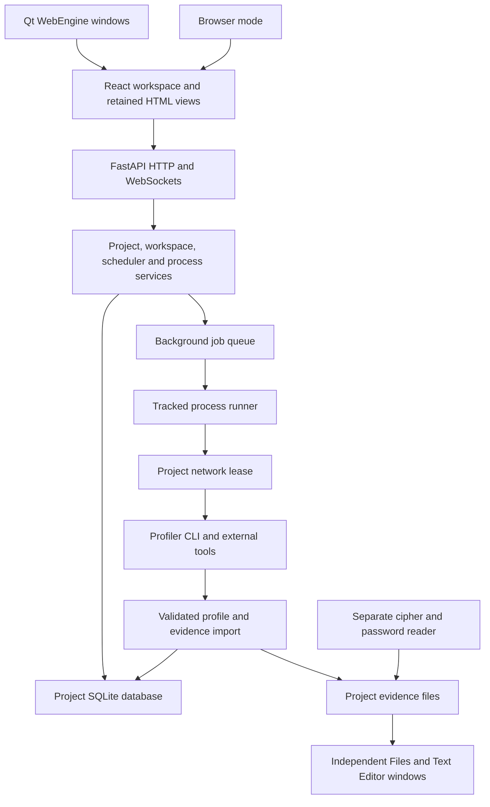

# FlagHop architecture

FlagHop is a modular monolith with separate tool processes. Most application
features share one Python runtime and one SQLite database per project. Modules
separate their responsibilities; they are not independently deployed services
or dynamically loaded plug-ins.

## Ownership

| Area | Responsibility |
| --- | --- |
| [`frontend/src/hub`](../frontend/src/hub) | Project navigation, hardware map, setup, reader and Deep scan panels. React state and project-ID guards prevent late responses replacing another workspace. |
| [`frontend/src/activity`](../frontend/src/activity) | Jobs, processes, output, approvals and other migrated activity panels. |
| [`app/desktop.py`](../app/desktop.py) and [`desktop_documents.py`](../app/desktop_documents.py) | Native windows around the same localhost app. Window controls use a narrow trusted-origin Qt bridge. |
| [`app/api`](../app/api) | FastAPI routes and application/page compositions. OpenAPI generates TypeScript client types from the canonical contracts. |
| [`app/contracts`](../app/contracts) | Definition-only actions/results, observations and artifact references, using approved roots. Parsers, runners, storage and HTTP services stay outside. See [authoring and quality gate](contract-authoring.md). |
| [`app/web`](../app/web) | HTML/JavaScript assets, templates, job manager and framework-independent service adapters. There is no second web application. |
| [`app/services`](../app/services) | Project catalog, workspace/session state, process registry, settings, events and network policy. |
| [`app/web/jobs.py`](../app/web/jobs.py) | Bounded in-memory queue with background workers, exclusive jobs and cancellation. Completion callbacks persist results before terminal publication and release; write failures become visible job failures. |
| [`app/processes`](../app/processes) | Tracked child processes, output, activity/time limits and cancellation. Scanner argv bypasses shell interpretation; older command paths retain their compatibility API. |
| [`app/services/network_guard.py`](../app/services/network_guard.py) | Checks the captured project network reference and enforces egress for a private process group/GID and its descendants. Failed verification holds work. |
| [`app/scanning`](../app/scanning) | Thin scanner adapter: source verification, job ownership, proxy registration, profile validation, import and durable results. |
| [`vendor/ctf_profiler`](../vendor/ctf_profiler) | Byte-identified standalone scanner modules and small inputs. Tools/environments are installed separately; the app does not merge scanner internals into its runtime. |
| [`app/scheduler`](../app/scheduler) | Existing rule planning, risk/policy decisions, approvals and execution orchestration. Metasploit execution is not added by the scanner adapter. |
| [`db`](../db) | SQLAlchemy entities, repositories and per-project SQLite persistence. |

## Execution and evidence

1. A Deep scan accepts a selected host ID/literal IP, expected network revision,
   timeout and optional resolver. Commands, scanner source and output paths are
   app-owned. Active scans are deduplicated per project/device.
2. The service verifies project/device identity, scope and configuration. Queued
   source is pinned to an immutable owned copy. The tracked runner launches the
   CLI with a deadline, bounded output and the original project's network lease.
3. Linux egress restrictions apply to the command's private GID and descendants.
   The scanner proxy registers only a listener proven to belong to that scan;
   its forwarding remains restricted to the target and permitted ports. Changed
   routes/configuration interrupt work. Unverified ownership or missing privilege
   holds execution/cleanup. See [supported setup](setup.md).
4. Before inventory writes, import validates typed facts, the complete summary,
   source/profile hashes, target, retained evidence paths/checksums and matching
   single-target XML. Hypotheses, candidates and reproduced findings remain
   distinct; process success does not establish a finding or session.
5. Inventory and its idempotency marker commit together. Summaries enter SQLite;
   profiles/raw evidence stay in `workspace-tool-output/deep-scans/[run id]`.
   Working/History and evidence opening consume those retained results.

Chrome ELF and selected WPScan application files receive a before/after audit
in addition to the standalone scanner audit. Unknown layouts remain unmeasured;
shared OS/browser libraries and arbitrary Ruby dependencies/plugins are outside
that coverage. Scanner bundle updates use the explicit inventory/review-digest
workflow in [`scripts/update-scanner.py`](../scripts/update-scanner.py).

## Persistence and compatibility

The project catalog maps stable IDs to workspace databases/folders. Runtime and
catalog operations share one reentrant lock; scanner transactions bind their
workspace and recheck identity before import. Late UI responses cannot replace
another selected project's data. WebSocket invalidations have polling fallback.

Jobs stay active/exclusive through result settlement. Persistence failures remain
visible separately from execution outcomes. The bounded in-memory queue does not
survive restart. A private execution journal outside copied/exported workspaces
records trusted ownership before child execution; shutdown stops admission,
requests cancellation and waits on one bounded deadline.

Recovery verifies process identity before owned cleanup and can settle validated
saved results offline. It never replays network commands or trusts copied PID/GID
metadata as signalling authority. Inventory/database/file settlement has retryable
stages; it is not one cross-store transaction. Missing exit evidence stays partial.

Save-as/restore preserve full results, extensions, lineage and original evidence,
clear copied execution controls and stop copied readers. Unowned active history
becomes interrupted. Unresolved protected execution blocks saving/copying/moving
the original workspace and further network runs there. Transfers use bounded
streaming/staging, destination-space reservations and atomic adoption/rollback.

History polling retains at most 200 compact rows with a 4 MiB serialized-entry
cache; details load on expansion. Directory/stat work still grows with history.
SQLite initialization supports existing `.legion` workspaces, including nullable
execution links. Original evidence is not rewritten by editor drafts or recovery.

## Remaining limits

`WebRuntime` remains a broad facade. Host/service, graph and settings views still
include imperative HTML/JavaScript. Pure canonical contracts are shared by the
API, parsers, services and generated frontend types; service-level ownership and
filesystem checks remain necessary after schema validation.

Readers use separate processes and project-scoped control/heartbeat/result files.
Their Start/Stop controls do not control Deep scans. Independent multi-project
execution, general workflow resumption, remote Files and unified Metasploit
actions/sessions remain separate work; see [product scope](product.md).
